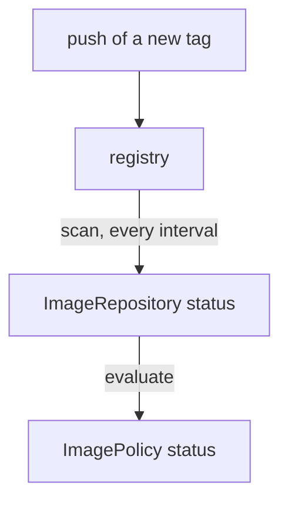

# Scan And Reflection Timing

A new tag is pushed to the registry. How long until the policy chooses it, and how can you make it faster? The answer depends on three clocks that run in different places. This part names each clock, shows the order of events from a push to a choice, and lists the tools that start a scan on demand or stop it.

## Three clocks

The first clock is the `interval` of the `ImageRepository`. At each interval the image reflector controller lists the tags of the registry and stores the result in the status. The second clock is the `interval` of an `ImagePolicy`, which only matters when `digestReflectionPolicy` is `Always`: it sets how often the controller reads the digest again. The third is a manual request, made with `flux reconcile`, which starts a scan or an evaluation now.

The policy has no clock of its own for the choice. When the scan stores a new tag list, the controller evaluates every policy that refers to that `ImageRepository` and writes the new choice. So the delay from a push to a choice is the time until the next scan, plus a short evaluation.



The diagram shows a pushed tag reaching the registry, the scan copying the tag list into the status of the `ImageRepository`, and the evaluation writing the choice to the `ImagePolicy`.

## Measure the delay

The commands below need the `ImageRepository` `podinfo` and an `ImagePolicy` named `range-x` with the range `6.x`, both in `flux-system`. Read the time of the last scan:

<!-- astrona:playground:renew -->

```sh
kubectl -n flux-system get imagerepository podinfo -o jsonpath='{.status.lastScanResult.scanTime}{"\n"}'
```

The value is a time stamp in UTC. Run the same command a minute later and the value has moved by about one interval. Now add a tag and watch the policy, without asking for a scan:

```sh
kubectl -n registry exec deploy/registry-tools -- \
  regctl image copy registry.localtest.me:5000/podinfo:6.15.0 registry.localtest.me:5000/podinfo:6.15.1
kubectl -n flux-system get imagepolicy range-x -o jsonpath='{.status.latestRef.tag}{"\n"}'
```

The policy still shows the old tag. Wait for the next scan, up to the one-minute interval, and ask again. It moves to `6.15.1` when the scan has stored the new tag.

## Start a scan now

The command `flux reconcile image repository` asks the controller to scan immediately. It does this by writing the annotation `reconcile.fluxcd.io/requestedAt` on the object with the current time, and the controller scans when it sees a new value:

```sh
kubectl -n registry exec deploy/registry-tools -- \
  regctl image copy registry.localtest.me:5000/podinfo:6.15.0 registry.localtest.me:5000/podinfo:6.15.2
flux reconcile image repository podinfo
kubectl -n flux-system get imagepolicy range-x -o jsonpath='{.status.latestRef.tag}{"\n"}'
```

The policy shows `6.15.2` within seconds. A manual reconcile changes only the time of this scan. The interval stays as it was, so use the manual command to test and not as part of a normal release.

## Choose the scan interval

A short interval gives a fast release and a long interval saves requests. Each scan sends at least one request for the tag list to the registry. A public registry limits the requests from one address per hour, and a cluster with many `ImageRepository` objects with a one-minute interval can reach that limit. A registry that is slow or limits requests answers with an error, and the next scan tries again.

Typical choices follow the use of the cluster. A development cluster that deploys on every commit uses one to five minutes. A production cluster that follows tags released by a pipeline often uses five to fifteen minutes. The interval of the `ImageRepository` is the speed limit for everything that depends on it, so a release pipeline that must finish in two minutes cannot sit behind a fifteen-minute scan.

## Stop a scan

Sometimes a scan must stop, for example during a registry migration. The `suspend` field, set with the command below, stops the controller from scanning and evaluating until you resume:

```sh
flux suspend image repository podinfo
kubectl -n registry exec deploy/registry-tools -- \
  regctl image copy registry.localtest.me:5000/podinfo:6.15.0 registry.localtest.me:5000/podinfo:6.15.3
flux get image repository podinfo
```

The `flux get` output shows `SUSPENDED` as `True`. After a few minutes the time of the last scan has not moved, and the policy does not see `6.15.3`. A manual `flux reconcile` of a suspended object is refused. Resume and the scan runs at once:

```sh
flux resume image repository podinfo
flux get image policy range-x
```

A suspend made with the command exists only in the cluster, and nobody who reads the repository sees it. A longer stop belongs in the file in Git as `suspend: true`.

You can now explain why a tag is not chosen yet, speed up a test, and stop the controller on purpose. When something is wrong and no timer explains it, the status of the objects holds the answer.

## Common pitfalls

> [!WARNING]
> - **Expecting the policy to react to the push.** The controller only learns about a tag at the next scan.
> - **Setting a policy `interval` to speed up the choice.** The policy interval only changes how often a digest is read. The scan interval sets the delay.
> - **A one-second scan interval.** It repeats the request against the registry for no gain and can hit a rate limit.
> - **Suspending with the command and forgetting it.** The object stays suspended and nobody sees why. Check `flux get image repository` for `SUSPENDED`.
