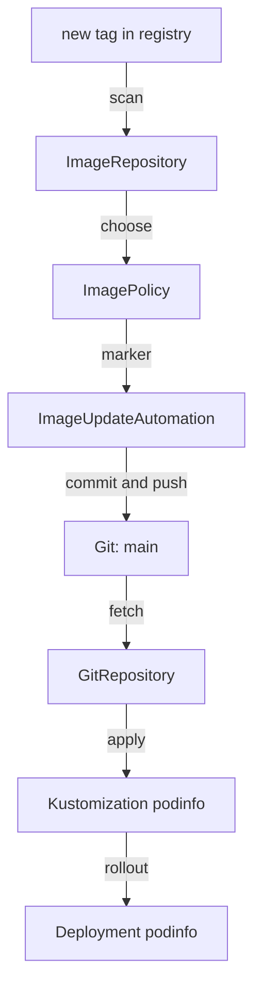

# ImageUpdateAutomation And The Release Loop

The tag line in `apps/podinfo/kustomization.yaml` now carries a setter marker for the policy `podinfo`, and the policy has chosen `6.14.1`. The cluster still runs `6.14.0`, because no controller acts on the marker. This part writes the object that does, follows one tag all the way from the registry to a running pod, and shows which command speeds up each step when you do not want to wait.

## What ImageUpdateAutomation does

An `ImageUpdateAutomation` tells the image automation controller where to write and how to commit. At each interval the controller does five things in order: it clones the branch it is told to check out, looks for setter markers in the files under `update.path`, replaces each marked value with its policy's choice, commits if any file changed, and pushes the commit. The fields map onto those steps:

| Field | What it decides |
| --- | --- |
| `sourceRef` | The `GitRepository` to clone; its URL and its credentials are reused |
| `git.checkout.ref.branch` | The branch to clone; without it, the branch of the `GitRepository` |
| `update.path` | The folder searched for markers; the default is the repository root |
| `update.strategy` | `Setters`, the only strategy and the default |
| `git.commit.author` | The `email` (required) and `name` of the commit author |
| `git.commit.messageTemplate` | The commit message, as a Go template |
| `git.push.branch` | The branch to push to |
| `interval` | How often the controller checks |

The controller pushes with the credentials of the `GitRepository`, so those credentials need write access. In this lab the user `gitops` has it. With a real Git server you give Flux a deploy key or a token that can write.

## Write the automation

The commands below need the marker on `newTag` in your clone of `gitops/fleet`, and the port-forward to Gitea running in your second terminal.

<!-- astrona:playground:renew -->

Save this as `clusters/kind/image-automation.yaml` in your clone:

```yaml
apiVersion: image.toolkit.fluxcd.io/v1
kind: ImageUpdateAutomation
metadata:
  name: podinfo
  namespace: flux-system
spec:
  interval: 1m
  sourceRef:
    kind: GitRepository
    name: fleet
  git:
    checkout:
      ref:
        branch: main
    commit:
      author:
        name: fluxcdbot
        email: fluxcdbot@example.com
      messageTemplate: "Automated image update by {{ .AutomationObject }}"
    push:
      branch: main
  update:
    path: ./apps/podinfo
    strategy: Setters
```

The automation clones `main` of the repository behind the `GitRepository` `fleet`, searches `apps/podinfo` for markers, and pushes back to `main` as `fluxcdbot`. Commit and push it, then make Flux apply it:

```sh
git add clusters/kind/image-automation.yaml
git commit -m "Automate podinfo releases"
git push
flux reconcile kustomization fleet --with-source
```

Within a minute the controller runs for the first time. Check it, then pull the commit it made:

```sh
flux get image update podinfo
git pull
git log -1 --format='%an <%ae> %s'
grep newTag apps/podinfo/kustomization.yaml
```

The automation reports the commit it pushed; `.status.lastPushCommit` holds its hash. The newest commit in your clone is by `fluxcdbot <fluxcdbot@example.com>` with the message from the template, and the `newTag` line now says `6.14.1`, with the marker still at the end. The controller rewrote the value and kept the comment.

## Follow the tag into the cluster

The commit is in Git, and the rest is ordinary Flux. The `GitRepository` `fleet` fetches the new commit, and the Flux `Kustomization` `podinfo` applies `apps/podinfo`. Speed both up instead of waiting for their intervals, and watch the rollout:

```sh
flux reconcile kustomization podinfo --with-source
kubectl -n podinfo rollout status deployment/podinfo
kubectl -n podinfo get deployment podinfo -o jsonpath='{.spec.template.spec.containers[0].image}{"\n"}'
```

The Deployment now runs `ghcr.io/stefanprodan/podinfo:6.14.1`. No person changed a tag, and Git still describes exactly what runs.



The diagram shows the release loop: two controllers turn a tag into a commit, and two other controllers turn the commit into a rollout.

## Run the loop once more, fast

Each step in the loop waits for its own interval, so a release takes a few minutes on its own. When you want it now, nudge each step in order. Copy `6.15.0` into the registry and run the loop by hand:

```sh
push_podinfo_tag() {
  kubectl -n registry exec deploy/registry-tools -- \
    regctl image copy "ghcr.io/stefanprodan/podinfo:$1" "registry.localtest.me:5000/podinfo:$1"
}
push_podinfo_tag 6.15.0
flux reconcile image repository podinfo
flux reconcile image update podinfo
flux reconcile kustomization podinfo --with-source
kubectl -n podinfo rollout status deployment/podinfo
```

The scan finds `6.15.0`, the policy chooses it, the automation commits it, and the Flux `Kustomization` applies it. `git pull` in your clone shows a second commit by `fluxcdbot`.

You can now automate a release from end to end, and you know which object owns each step, so you know where to look when a release stops. The commits all go straight to `main` with a fixed message. Teams often want more control over that history.

## Common pitfalls

> [!WARNING]
> - **An `update.path` that misses the marked file.** The controller finds no markers and never commits. The path is relative to the repository root.
> - **Credentials that can only read.** The clone works and the push fails. The automation pushes with the `GitRepository`'s credentials.
> - **Pushing to a branch Flux does not apply.** The commit lands, and the cluster never sees it.
> - **Editing the tag by hand while the automation runs.** The next run writes the policy's choice back. Change the policy instead.
> - **Waiting for every interval when testing.** Run `flux reconcile image repository`, `flux reconcile image update` and `flux reconcile kustomization --with-source` in that order.

## Your mission: Automate The podinfo Release

You can now mark a field and commit an `ImageUpdateAutomation` that turns a new tag into a commit and a rollout. The graded lab gives you the scan and the policy, and asks you to mark the tag and add the automation in Git, so that a new podinfo release reaches the running Deployment through a commit by the automation.

The lab runs in its own cluster, so first pause your playground. Nothing in it is lost:

```sh
astrona stop ats-098-playground-020-01
```

Then start the lab:

```sh
astrona run --git ssh://git@github.com/astrona-io/ATS098.git -c sections/section-020/module-01/labs/lab-01
```

The task is on the next page. Solve it on your own first. When you think you are done, send it for grading:

```sh
astrona submit -c sections/section-020/module-01/labs/lab-01
```

When the lab is done, remove it and start your playground again:

```sh
astrona destroy ats-098-lab-020-01
astrona start ats-098-playground-020-01
```
