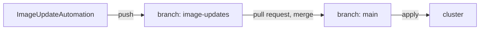

# Commit Messages, Authors And Branches

The automation now commits every release straight to `main` with the same one-line message. That works, and it leaves two questions open. Six months later, can someone read the history and see what each release changed? And should a new release reach production without anyone looking at it first? This part answers both: a commit message template that lists what changed, and a push branch that turns each release into a branch someone merges.

## The commit author and message

Every commit from the automation carries the `name` and `email` from `git.commit.author`. Use an address that belongs to the automation, not to a person. Then `git log --author` separates releases from human changes, and branch protection rules on a real Git server can treat the automation on its own.

The message comes from `git.commit.messageTemplate`, a template in Go's text template language: text with fields in double braces. The controller fills in these fields:

| Field | What it holds |
| --- | --- |
| `.AutomationObject` | The namespace and name of the `ImageUpdateAutomation` |
| `.Changed.FileChanges` | The files that changed, so a template can list them |
| `.Changed.Objects` | The objects that changed |
| `.Changed.Changes` | Every single value that changed |
| `.Values` | Extra values you can set on the object |

Older Flux versions offered a field called `.Updated`. It is gone; templates that use it fail.

## A template that lists the files

The commands below need the `ImageUpdateAutomation` `podinfo` in `clusters/kind/image-automation.yaml` of your clone of `gitops/fleet`, and the port-forward to Gitea running in your second terminal.

<!-- astrona:playground:renew -->

Change the `commit` part of `clusters/kind/image-automation.yaml` so it reads:

```yaml
    commit:
      author:
        name: fluxcdbot
        email: fluxcdbot@example.com
      messageTemplate: |
        Automated image update

        Automation name: {{ .AutomationObject }}

        Files:
        {{ range $filename, $_ := .Changed.FileChanges -}}
        - {{ $filename }}
        {{ end -}}
```

The `range` loop runs once for each changed file and prints its name. The `-` inside the braces removes the line break next to it, so the list has no empty lines. Commit and push it, and apply it:

```sh
git commit -am "List the changed files in release commits"
git push
flux reconcile kustomization fleet --with-source
```

The next release commit uses the new message. You see it in the next step.

## Push releases to a branch for review

Some teams want a person to approve every release. The automation can still do the work: it checks out `main`, but pushes to a different branch. A person then opens a pull request from that branch and merges it. Flux only applies `main`, so nothing reaches the cluster until the merge.



The diagram shows the automation writing to its own branch, and only the merge to `main` reaching the cluster.

Change the `push` part of `clusters/kind/image-automation.yaml` so it reads:

```yaml
    push:
      branch: image-updates
```

To have something to release, set the tag in `apps/podinfo/kustomization.yaml` back to `6.14.1` by hand and keep the marker. The policy still chooses `6.15.0`, so the automation sees a marked value that does not match and writes it again. Commit both files and push:

```sh
sed -i.bak 's/newTag: 6.15.0/newTag: 6.14.1/' apps/podinfo/kustomization.yaml && rm apps/podinfo/kustomization.yaml.bak
git commit -am "Push releases to image-updates; roll back to 6.14.1 to test"
git push
flux reconcile kustomization fleet --with-source
flux reconcile image update podinfo
```

Then look at both branches:

```sh
git fetch
git log -1 --format='%an%n%B' origin/image-updates
git log -1 --format='%an %s' origin/main
```

The branch `image-updates` exists now, and its newest commit is by `fluxcdbot`, with the message that lists `apps/podinfo/kustomization.yaml`. `main` still ends with your own commit, so the cluster runs `6.14.1`. On a real Git server you would now open a pull request. Here, merge it yourself and let Flux apply it:

```sh
git merge --ff-only origin/image-updates
git push
flux reconcile kustomization podinfo --with-source
kubectl -n podinfo get deployment podinfo -o jsonpath='{.spec.template.spec.containers[0].image}{"\n"}'
```

podinfo runs `6.15.0` again, and this time a person decided when. Set `push.branch` back to `main` in your clone when you are done, so the playground releases on its own again.

You can now shape the history the automation writes, and choose between releases that go straight to production and releases that wait for a merge. Both keep Git as the only place where the desired state changes.

## Common pitfalls

> [!WARNING]
> - **A template that uses `.Updated`.** That field no longer exists. Use `.Changed`.
> - **A person's email as the author.** The history then mixes automated and human changes.
> - **Pushing to a review branch and forgetting to merge.** Flux applies `main`, so releases wait in the branch.
> - **A checkout branch and a push branch that drift apart.** The automation checks out the `checkout` branch each time; if the push branch has commits that are not on it, the push can fail.
> - **Editing the marked value by hand and expecting it to stay.** The next run writes the policy's choice again.
