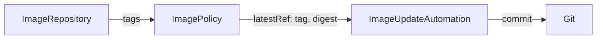

# Pinning Images By Digest

A tag is a name, and a registry lets the owner of the repository move a name to another image. `latest` is the well-known example, and a build pipeline that pushes `main` again does the same. When the tag stays the same and the image changes, a policy that only looks at tags sees nothing new. A digest does not have this problem. This part adds the digest to the policy and writes it to Git.

## What a digest is

A digest is the hash of the image manifest, written as `sha256:` and 64 hexadecimal characters. A manifest is the small file that lists the layers of an image. Two images with the same digest are the same image, byte for byte, and one tag can point at different digests over time. A reference with a digest, such as `ghcr.io/stefanprodan/podinfo@sha256:...`, pulls exactly one image.

## digestReflectionPolicy

The `ImagePolicy` stores the digest of the chosen tag in `.status.latestRef.digest`, but only when you ask for it with `spec.digestReflectionPolicy`. It has three values:

| Value | What the controller does |
| --- | --- |
| `Never` | It does not store a digest |
| `IfNotPresent` | It stores the digest once, the first time it sees the tag, and does not look again |
| `Always` | It reads the digest again at every `interval` of the policy, so a moved tag is noticed |

`Always` needs the field `spec.interval` on the policy, because the policy must know how often to ask. A digest only changes the result when it is stored, so set the field explicitly.

## Add a digest policy

The commands below need your clone of `gitops/fleet`.

<!-- astrona:playground:renew -->

Save this as `clusters/kind/image-podinfo-digest.yaml`:

```yaml
apiVersion: image.toolkit.fluxcd.io/v1
kind: ImagePolicy
metadata:
  name: podinfo-digest
  namespace: flux-system
spec:
  imageRepositoryRef:
    name: podinfo
  digestReflectionPolicy: Always
  interval: 5m
  policy:
    semver:
      range: '6.x'
```

The policy reuses the `ImageRepository` `podinfo` and chooses the same tag as the policy `podinfo`. It also keeps the digest. Commit and push, and read the result:

```sh
git add clusters/kind/image-podinfo-digest.yaml
git commit -m "Reflect the digest of the chosen tag"
git push
flux reconcile kustomization fleet --with-source
kubectl -n flux-system get imagepolicy podinfo-digest -o jsonpath='{.status.latestRef}'
```

The status shows three fields: `name`, `tag` and `digest`. The `digest` field starts with `sha256:`.

## Write the digest with a marker

Add one line to the values file from the previous part, under `tag:`:

```yaml
  digest: sha256:0000000000000000000000000000000000000000000000000000000000000000 # {"$imagepolicy": "flux-system:podinfo-digest:digest"}
```

The all-zero value is a placeholder that the controller replaces. Commit, push and run the loop:

```sh
git commit -am "Pin the digest"
git push
flux reconcile kustomization fleet --with-source
flux reconcile image update podinfo
git pull
grep digest apps/podinfo/values.yaml
```

The `digest` line now holds the real digest of podinfo `6.14.0` in the lab registry. The commit has the tag and the digest from one policy, so they always belong together.



The diagram shows one policy giving both the tag and the digest to the automation.

You can now pin a release to exact image content. The automation still has to find the files, and the next part covers how it decides where to look.

## Common pitfalls

> [!WARNING]
> - **`digestReflectionPolicy: Always` without `interval`.** The policy is rejected, because it needs to know how often to read the digest.
> - **A `:digest` marker on a policy that does not reflect digests.** The field stays empty or unchanged.
> - **Digest and tag from two different policies.** They can describe two different images. Use one policy for both.
> - **Marking a field the chart does not read as a digest.** A chart that expects `name@sha256:...` in one string needs the full form of the field, not `:digest` alone.
