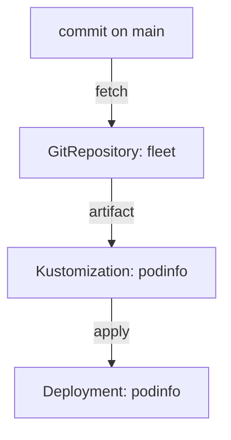

# Tracing A Release

Sometimes the start is not an image object, but a Deployment that runs a tag nobody expected. Someone asks who changed it and why. In a GitOps system the answer is a chain: the Deployment came from a Flux `Kustomization`, which came from a `GitRepository`, which came from a commit. The `flux trace` command walks that chain for you.

## What flux trace does

`flux trace` takes an object that Flux applied, and prints the objects that produced it. It reads the labels that Flux puts on every object it applies, finds the Flux `Kustomization` or `HelmRelease` that owns it, and then the source of that object. It also shows the revision, the branch and commit, and the last time it applied.

<!-- astrona:playground:renew -->

```sh
flux trace deployment podinfo -n podinfo
```

The output has sections. The first names the object. The next names the Flux `Kustomization` `podinfo` with its path `./apps/podinfo` and its last applied revision. The last names the `GitRepository` `fleet`, its URL, the branch and the revision, which is the branch name and the commit hash. The commit hash is the answer to "which commit put this here".

## From the commit back to the automation

A commit on `main` is either by a person or by the automation. Read the history of the marked file in your clone:

```sh
git pull
git log --format='%h %an <%ae> %s' -5 -- apps/podinfo/kustomization.yaml
```

The lines with the author `fluxcdbot` are release commits. The message template decides what each message says. The hash in `flux trace` appears in this list, and the author tells you who is responsible: a person, or the automation acting on the policy.

To go one step further, read what the policy chose at that time and what the automation reports now:

```sh
flux get image policy podinfo
kubectl -n flux-system get imageupdateautomation podinfo -o jsonpath='{.status.lastPushCommit}{"\n"}'
```

If `lastPushCommit` equals the hash from the trace, the automation made the commit that put the tag in the cluster. If it does not, a later commit by a person or another automation made the last change, and the tag in the cluster does not come from the loop at all.

## Trace a release in a different order

You can also begin at the commit and trace forward. Start from the `GitRepository`:

```sh
flux get source git fleet
flux get kustomization podinfo
flux get kustomization fleet
```

Read the revision in each line. A `GitRepository` that has the new commit and a `Kustomization` that still has the old one is waiting for its interval or has failed to apply. The line of the failing object carries the message that explains it.



The diagram shows the chain that `flux trace` prints from the bottom up.

You can now go from a running Deployment to the commit and its author, and from the commit forward to the cluster. The next part covers the moments when you want the loop to stop.

## Common pitfalls

> [!WARNING]
> - **Tracing an object that Flux did not apply.** `flux trace` finds no owner and says so.
> - **Reading the revision as a tag.** It is a branch name and a commit hash.
> - **Assuming every commit to the marked file is a release.** People edit the file too; read the author.
> - **Tracing without the namespace of the object.** Pass `-n` for any namespace other than the default.
