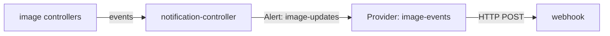

# Alerts And Providers For Image Events

A release loop that works in silence is hard to trust. A person only learns about a release by looking at Git. The Flux notification controller is the default controller that sends events out of the cluster. Every Flux controller records an event when something happens: a scan finds new tags, a policy chooses another tag, an automation pushes a commit. This part reads those events and sends them to a webhook.

## Events

An event is a Kubernetes object that records one thing that happened to another object. The image controllers create events with a reason and a message. Read the events of the automation with `flux events`:

<!-- astrona:playground:renew -->

```sh
flux events --for ImageUpdateAutomation/podinfo
```

The list shows the push events, with the commit hash and the branch in the message, and the error events when a run fails. The `--for` flag takes `Kind/name` and accepts the kinds `ImageRepository` and `ImagePolicy` as well.

## Provider and Alert

Two objects of the notification controller send events out. A `Provider` says where to send: a type, such as `slack`, `generic` or `githubdispatch`, an address, and optionally a Secret that holds a token. An `Alert` says what to send: the sources to watch, the lowest severity, and the provider to use.

Save this as `clusters/kind/image-alerts.yaml` in your clone of `gitops/fleet`:

```yaml
apiVersion: notification.toolkit.fluxcd.io/v1beta3
kind: Provider
metadata:
  name: image-events
  namespace: flux-system
spec:
  type: generic
  address: http://event-sink.flux-system.svc.cluster.local:8080/
---
apiVersion: notification.toolkit.fluxcd.io/v1beta3
kind: Alert
metadata:
  name: image-updates
  namespace: flux-system
spec:
  providerRef:
    name: image-events
  eventSeverity: info
  eventSources:
    - kind: ImageRepository
      name: podinfo
    - kind: ImagePolicy
      name: podinfo
    - kind: ImageUpdateAutomation
      name: podinfo
```

The `generic` type sends each event as an HTTP POST with a JSON body. Nothing listens at the address in the playground, which is enough to create the objects; the notification controller reports a failed delivery in its log and does not stop. `eventSeverity: info` includes normal events, and `error` limits the alert to failures. Commit, push and apply:

```sh
git add clusters/kind/image-alerts.yaml
git commit -m "Alert on image events"
git push
flux reconcile kustomization fleet --with-source
kubectl -n flux-system get provider,alert
```

Both objects are listed. In a real cluster, the address is a Slack webhook, a chat system or a pipeline trigger, and the people who ship the application see each release appear in their channel.

## What to watch

An `Alert` can name many sources, and `name: '*'` matches every object of a kind in the namespace. Watch the automation for pushes and failures, the policy for changes of the chosen tag, and the repository for scan errors. Do not watch the `ImageRepository` at `info` severity if it scans every minute; most events are about the same state. Use `error` for objects that are noisy.



The diagram shows events going from the image controllers through the notification controller to the webhook that the Provider names.

You can now make the loop tell people what it does. The last part collects the faults that stop a release and the evidence for each.

## Common pitfalls

> [!WARNING]
> - **An `Alert` without the automation as a source.** The commit events never leave the cluster.
> - **A `providerRef` name that does not match a Provider in the same namespace.** The Alert is not ready.
> - **`eventSeverity: info` on a source that scans every minute.** The channel fills with noise.
> - **A token in the Provider YAML.** Put it in a Secret and reference it with `secretRef`.

## Your mission: Alert On Image Updates

You can now read image events and send them out with a `Provider` and an `Alert`. The graded lab gives you a loop that never commits, and asks you to find out why, fix it in Git, and add the alert, so that a new release reaches Git and its events leave the cluster.

The lab runs in its own cluster, so first pause your playground. Nothing in it is lost:

```sh
astrona stop ats-098-playground-020-03
```

Then start the lab:

```sh
astrona run --git ssh://git@github.com/astrona-io/ATS098.git -c sections/section-020/module-03/labs/lab-01
```

The task is on the next page. Solve it on your own first. When you think you are done, send it for grading:

```sh
astrona submit -c sections/section-020/module-03/labs/lab-01
```

When the lab is done, remove it and start your playground again:

```sh
astrona destroy ats-098-lab-020-03
astrona start ats-098-playground-020-03
```
