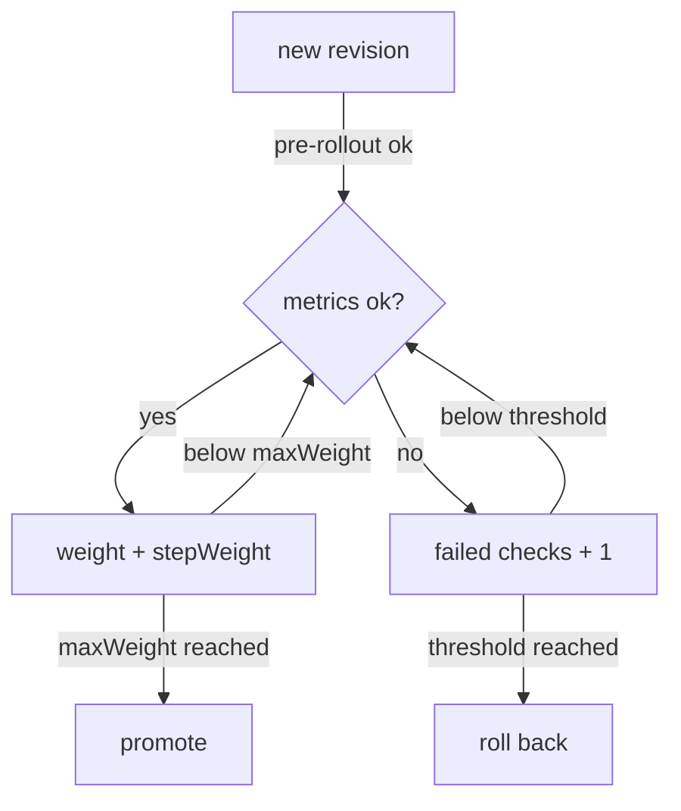

# Canary Analysis, Promotion And Rollback

The `Canary` for podinfo is initialized: `podinfo-primary` serves every request, and the Deployment `podinfo` waits at zero replicas. Now release a new version and watch Flagger earn the right to promote it. Then break a release on purpose, because a safety step you have never seen work is not a safety step.

## The analysis loop

When the pod template of the target Deployment changes, for example its image tag, Flagger starts an analysis. First it scales the Deployment `podinfo` up and waits until its pods are ready, for at most `progressDeadlineSeconds`. Then it runs the `pre-rollout` webhooks. After that it repeats one check every `interval`:



The diagram shows the loop: each good check raises the canary's share of traffic, each bad check counts against the release, and reaching `maxWeight` or `threshold` ends it.

With the values in your `Canary` (`interval: 15s`, `stepWeight: 25`, `maxWeight: 50`, `threshold: 5`), a good release takes two steps, 25% and then 50% of the traffic, about half a minute, and then the promotion. To promote, Flagger copies the template of `podinfo` into `podinfo-primary`, waits for the rollout, moves all traffic back to the primary and scales `podinfo` to zero. A bad release is rolled back after five failed checks: all traffic returns to the primary, and the canary is scaled to zero.

A check is good when every metric is inside its `thresholdRange`. `request-success-rate` is built into Flagger for nginx: the share of requests to the canary Ingress, over the metric's `interval` of one minute, that did not end with a 5xx status code. `min: 99` means at least 99% must succeed.

## Release a new version

This page needs the `Canary` `podinfo` initialized and your clone of `gitops/fleet`, with the port-forward to Gitea running in your second terminal. Release `6.14.1` the GitOps way: change the tag in Git.

<!-- astrona:playground:renew -->

```sh
sed -i.bak 's/newTag: 6.14.0/newTag: 6.14.1/' apps/podinfo/kustomization.yaml && rm apps/podinfo/kustomization.yaml.bak
git commit -am "Release podinfo 6.14.1"
git push
flux reconcile kustomization podinfo --with-source
```

Flux changes the Deployment `podinfo`, and Flagger notices. Watch the `Canary`; the `WEIGHT` column shows the canary's share of the traffic:

```sh
kubectl -n podinfo get canary podinfo --watch
```

The status moves to `Progressing` with weight `0` while the new pods start, then to weight `25` and `50`, then back to `0` as Flagger promotes, and ends at `Succeeded`. It takes a few minutes. Stop the watch with Ctrl+C, and read the story Flagger wrote:

```sh
kubectl -n podinfo describe canary podinfo | sed -n '/^Events:/,$p'
kubectl -n podinfo get deployment podinfo-primary -o jsonpath='{.spec.template.spec.containers[0].image}{"\n"}'
```

The events name each step: a new revision detected, the canary scaled up, each weight advance, the copy of the template to the primary, and the promotion. The primary now runs `ghcr.io/stefanprodan/podinfo:6.14.1`.

## Cause a rollback

A release that passes on a quiet lab application proves little, so make the next one fail. Release `6.15.0`, and while it is in analysis, send the canary requests that fail. podinfo answers `/status/500` with the status code 500, on purpose.

```sh
sed -i.bak 's/newTag: 6.14.1/newTag: 6.15.0/' apps/podinfo/kustomization.yaml && rm apps/podinfo/kustomization.yaml.bak
git commit -am "Release podinfo 6.15.0"
git push
flux reconcile kustomization podinfo --with-source
```

As soon as `kubectl -n podinfo get canary podinfo` shows `Progressing` with a weight above `0`, send two minutes of failing requests through ingress-nginx. Because Flagger sends part of the traffic to the canary, part of these requests reach `6.15.0` and fail there:

```sh
kubectl -n podinfo exec deploy/flagger-loadtester -- \
  hey -z 2m -q 10 -c 2 -host app.example.com http://ingress-nginx-controller.ingress-nginx/status/500
```

When `hey` finishes, read the result:

```sh
kubectl -n podinfo get canary podinfo
kubectl -n podinfo describe canary podinfo | sed -n '/^Events:/,$p'
kubectl -n podinfo get deployment podinfo-primary -o jsonpath='{.spec.template.spec.containers[0].image}{"\n"}'
```

The status is `Failed`. The events show the success rate below 99% at each check, the advance halted, and after five failed checks the rollback. The primary still runs `6.14.1`, so users only ever saw the failing version for their share of a few steps.

Look at what that means for GitOps: Git says `6.15.0`, the Deployment `podinfo` says `6.15.0` at zero replicas, and users get `6.14.1` from the primary. Flagger does not change Git. The next change to the Deployment starts a new analysis; to give up on `6.15.0`, put `6.14.1` back in Git.

You can now read an analysis from its fields, follow a promotion through the events, and you have seen a rollback protect the primary. The analysis so far shifts a share of all users. Sometimes you want to choose which users see the new version.

## Common pitfalls

> [!WARNING]
> - **No traffic during the analysis.** `request-success-rate` has no data, the check fails, and a good release is rolled back. Keep the load-test webhook.
> - **Changing the target Deployment during an analysis.** Flagger starts the analysis again from the beginning.
> - **Reading `Succeeded` as "the new version runs".** Check the image of `podinfo-primary`; that is what serves users.
> - **Expecting a rollback to change Git.** Git still names the failed version until you change it.
> - **`skipAnalysis: true` to get a release out.** It promotes without any check, so the `Canary` protects nothing.

## Your mission: Promote A New Version Through A Canary

You can now write a `Canary`, release a version through Git, and confirm that Flagger promoted it. The graded lab gives you podinfo behind ingress-nginx without a `Canary`, and asks you to add one with a given analysis in Git and release podinfo `6.14.1` through it.

The lab runs in its own cluster, so first pause your playground. Nothing in it is lost:

```sh
astrona stop ats-098-playground-030-01
```

Then start the lab:

```sh
astrona run --git ssh://git@github.com/astrona-io/ATS098.git -c sections/section-030/module-01/labs/lab-01
```

The task is on the next page. Solve it on your own first. When you think you are done, send it for grading:

```sh
astrona submit -c sections/section-030/module-01/labs/lab-01
```

When the lab is done, remove it and start your playground again:

```sh
astrona destroy ats-098-lab-030-01
astrona start ats-098-playground-030-01
```
