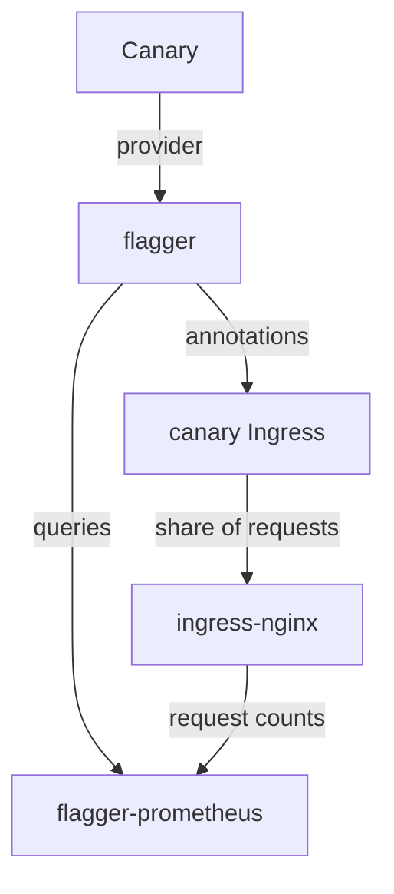

# Flagger Providers And Installation

Flagger does not carry traffic. It changes the configuration of something that does, and that something decides what Flagger can do. A team that picks a router before it reads the provider list can end up with a router that cannot match a header, or a mesh that does not exist in its cluster. This part names the providers, installs Flagger the way the playground did, and checks what the installation created.

## What a provider is

A provider is the router or service mesh that Flagger controls through the `provider` field of a `Canary`. For each provider, Flagger knows which objects to create and change. With `provider: nginx`, Flagger creates a second Ingress, the canary Ingress, and sets ingress-nginx annotations on it. With `provider: istio`, Flagger changes an Istio `VirtualService`. With `provider: gatewayapi`, it changes an `HTTPRoute`.

The table lists the providers that Flagger 1.45 supports for the strategies in this module. It names the strategies each one carries out.

| Provider | What Flagger changes | Strategies |
| --- | --- | --- |
| `kubernetes` | Kubernetes Services only, no router | Blue/green |
| `nginx` | A canary Ingress with ingress-nginx annotations | Canary release, A/B testing |
| `istio` | A `VirtualService` | Canary release, A/B testing, blue/green with mirroring |
| `linkerd` | An SMI `TrafficSplit` | Canary release |
| `gatewayapi` | An `HTTPRoute` | Canary release, A/B testing, blue/green with mirroring |
| `contour`, `gloo`, `traefik`, `skipper`, `apisix` | The router's own routing objects | Canary release, and A/B testing on most |

The `kubernetes` provider is the only one that needs no router. It cannot send a share of the traffic anywhere, so it fits blue/green only. The other providers all shift traffic in some way. The ingress-nginx project stopped publishing new releases in March 2026, and the playground still uses it because the `Canary` fields stay the same with any provider.

## Install Flagger

Flagger installs from a Helm chart. Helm is a package manager for Kubernetes: a chart is a package, and a release is one installed copy of it. The chart needs to know the provider and, if you have no Prometheus, whether to install one. A person installs it by hand like this:

```sh
helm repo add flagger https://flagger.app
helm upgrade -i flagger flagger/flagger \
  --namespace ingress-nginx \
  --set meshProvider=nginx \
  --set prometheus.install=true
```

The playground did the same through Flux, and the file is in Git. It is a `HelmRelease` object, which the Flux helm controller turns into a Helm release. Its `values` hold the same two settings:

```yaml
  values:
    meshProvider: nginx
    prometheus:
      install: true
```

`meshProvider` becomes the default provider of the Flagger controller, so a `Canary` that leaves out `provider` uses it. `prometheus.install: true` starts a small Prometheus, `flagger-prometheus`, that Flagger configures to scrape the router. Without it, you point Flagger at your own Prometheus with the `metricsServer` value.

## Check what the chart created

The first command lists the Flux objects that installed everything. The commands below need no Git clone, because they only read the cluster.

<!-- astrona:playground:renew -->

```sh
flux get helmreleases
kubectl get crd | grep flagger.app
kubectl -n ingress-nginx get deployments
```

The `HelmRelease` objects `ingress-nginx`, `flagger` and `flagger-loadtester` are `Ready`. The custom resource definitions (CRDs), the types Flagger adds to the Kubernetes API, include `canaries.flagger.app`, `metrictemplates.flagger.app` and `alertproviders.flagger.app`. The namespace `ingress-nginx` holds the controller, `flagger` and `flagger-prometheus`.

The Flagger controller reads its provider and its Prometheus address from the arguments of its container. Print them:

```sh
kubectl -n ingress-nginx get deployment flagger \
  -o jsonpath='{.spec.template.spec.containers[0].args}{"\n"}'
```

The arguments include the mesh provider `nginx` and the metrics server address of `flagger-prometheus`. Those two values are what the chart's `meshProvider` and `prometheus.install` settings produced.



The diagram shows the loop in this playground: Flagger changes the canary Ingress, ingress-nginx splits the traffic, and Prometheus returns the request counts that Flagger reads.

You now know that the provider sets the strategies a `Canary` can use, and you saw where the playground's installation chose nginx. The next question is what a weighted canary release does step by step when you write the steps yourself.

## Common pitfalls

> [!WARNING]
> - **Choosing a provider the cluster does not have.** A `Canary` with `provider: istio` and no Istio never initializes.
> - **Expecting A/B testing from the `kubernetes` provider.** It has no router to match a header.
> - **Installing Flagger without a Prometheus address.** The built-in metrics have no data, and every analysis fails.
> - **Setting `meshProvider` on the chart and a different `provider` on the `Canary`.** The `Canary` wins, and Flagger changes objects of a router you may not run.
> - **Installing Flagger with `helm` in a cluster that Flux manages.** Nothing in Git describes it, so the next person cannot reproduce it.
