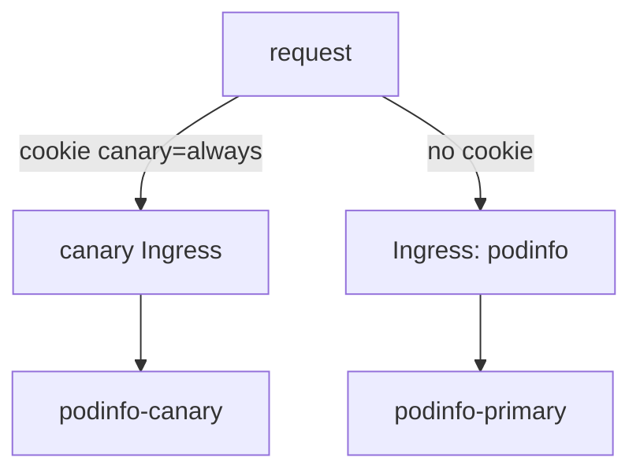

# A/B Testing With Headers And Cookies

A weighted canary release has a weak point for some applications: one user can see the old version on one request and the new version on the next. That breaks a login flow, and it hides a new feature from the people who should test it. An A/B test fixes both. It decides by a property of the request, and the same user, with the same header or cookie, always gets the same version. This part shows what Flagger changes in the router, then writes a cookie match.

## What Flagger changes in ingress-nginx

In an A/B test, Flagger does not raise a weight. It sets `iterations`, the number of checks to run, one per `interval`, and `match`, the condition a request must meet to reach the canary. If every iteration passes, Flagger promotes. If `threshold` checks fail, it rolls back.

ingress-nginx can send a request to a canary Ingress by a header or by a cookie, through annotations on that Ingress. Flagger writes those annotations from `match`. The mapping for the nginx provider is this:

| `match` entry | Annotation on the canary Ingress | What the client sends |
| --- | --- | --- |
| `headers: x-canary: exact: "insider"` | `canary-by-header: x-canary` and `canary-by-header-value: insider` | The header `X-Canary: insider` |
| `headers: cookie: exact: "canary"` | `canary-by-cookie: canary` | The cookie `canary=always` |

Every annotation name starts with `nginx.ingress.kubernetes.io/`. The nginx provider supports exact matches. Providers with richer routing, such as Istio, also support `regex` matches and match on the URI, method and other fields.

## Write the cookie match

This part needs your clone of `gitops/fleet`, the port-forward to Gitea in a second terminal, and the `Canary` `podinfo` with `autoscalerRef` from the part before, or one without it. Replace the `analysis` in `apps/podinfo/canary.yaml` so it reads:

<!-- astrona:playground:renew -->

```yaml
  analysis:
    interval: 15s
    threshold: 5
    iterations: 8
    match:
      - headers:
          cookie:
            exact: "canary"
    metrics:
      - name: request-success-rate
        thresholdRange:
          min: 99
        interval: 1m
    webhooks:
      - name: load-test
        url: http://flagger-loadtester.podinfo/
        timeout: 5s
        metadata:
          cmd: "hey -z 1m -q 10 -c 2 -H 'Cookie: canary=always' -host app.example.com http://ingress-nginx-controller.ingress-nginx/"
```

The load test sends the cookie, because only requests with the cookie reach the canary, and only canary traffic produces data for the success rate. Eight iterations at 15 seconds take about two minutes.

Change the message podinfo shows, so the two versions differ. An analysis starts when the pod template changes, not when the `Canary` changes. Commit and apply:

```sh
sed -i.bak 's/value: "released by Flux"/value: "cookie preview"/' apps/podinfo/deployment.yaml && rm apps/podinfo/deployment.yaml.bak
git commit -am "Test the cookie preview with an A/B canary"
git push
flux reconcile kustomization podinfo --with-source
```

## See the router change and the two answers

While `kubectl -n podinfo get canary podinfo` shows `Progressing`, print the annotations Flagger put on the canary Ingress:

```sh
kubectl -n podinfo get ingress podinfo-canary -o jsonpath='{.metadata.annotations}{"\n"}'
```

The annotations include `nginx.ingress.kubernetes.io/canary: "true"` and `nginx.ingress.kubernetes.io/canary-by-cookie: canary`. Then send one request with the cookie and one without, the way users reach the application:

```sh
kubectl -n podinfo exec deploy/flagger-loadtester -- \
  curl -s -H 'Host: app.example.com' -H 'Cookie: canary=always' http://ingress-nginx-controller.ingress-nginx/
kubectl -n podinfo exec deploy/flagger-loadtester -- \
  curl -s -H 'Host: app.example.com' http://ingress-nginx-controller.ingress-nginx/
```

The request with the cookie returns a `message` of `cookie preview`, from the canary. The request without it returns the old message, from the primary. The same user, with the same cookie, always reaches the canary until the promotion. When the iterations finish, Flagger promotes, and both requests return the new message.



The diagram shows ingress-nginx choosing the backend from the cookie, with no weight involved.

You can now send chosen users to a new version and show the router configuration that does it. The next step is to test a new version when no user should see it at all.

## Common pitfalls

> [!WARNING]
> - **A load test without the header or cookie.** No test traffic reaches the canary, the success rate has no data, and a good release fails.
> - **A cookie value other than `always`.** ingress-nginx sends a request to the canary when the cookie is `always` and keeps it on the primary when the cookie is `never`.
> - **Using `regex` with the nginx provider.** It supports exact matches only.
> - **Keeping `stepWeight` or `maxWeight` next to `iterations`.** One `Canary` uses the fields of one strategy.
> - **Changing only the `Canary`.** An analysis starts when the target Deployment changes.

## Your mission: Switch A Release To A/B Testing With A Header

You can now turn a weighted canary release into an A/B test and see the router change that carries it out. The graded lab starts with a weighted `Canary` on podinfo and asks you to change it, in Git, into an A/B test for the header `x-canary: insider`, and to release `6.14.1` through it.

The lab runs in its own cluster, so first pause your playground. Nothing in it is lost:

```sh
astrona stop ats-098-playground-030-02
```

Then start the lab:

```sh
astrona run --git ssh://git@github.com/astrona-io/ATS098.git -c sections/section-030/module-02/labs/lab-01
```

The task is on the next page. Solve it on your own first. When you think you are done, send it for grading:

```sh
astrona submit -c sections/section-030/module-02/labs/lab-01
```

When the lab is done, remove it and start your playground again:

```sh
astrona destroy ats-098-lab-030-02
astrona start ats-098-playground-030-02
```
