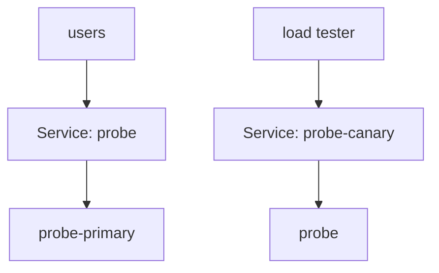

# Blue/Green And Traffic Mirroring

Some releases cannot be tested on user traffic at all. A change to a payment service must not answer a single real request with an untested version, even for 1% of users. For that case Flagger offers two strategies: blue/green, where the new version gets only test traffic until the switch, and traffic mirroring, where the new version receives a copy of real requests and its answers are thrown away. This part runs a blue/green release on the second Deployment, `probe`, and explains what mirroring needs.

## Blue/green with the kubernetes provider

In blue/green, the running version is blue and the new version is green. Flagger starts the green pods, runs the webhooks against them and checks the metrics for a number of `iterations`, and then switches all users to green in one step. During the test, users still get blue.

The `kubernetes` provider carries this out with plain Services, so it needs no router. Flagger creates three Services for a `Canary` named `probe`: `probe` and `probe-primary` point at the primary pods, and `probe-canary` points at the pods of the new version. Test traffic goes to `probe-canary` directly. The `kubernetes` provider has no built-in metrics, because no router counts the requests. The checks come from webhooks, which means from the load tester.



The diagram shows the test phase: users reach the primary, and only the load tester reaches the new version.

## Write the blue/green Canary

This part needs your clone of `gitops/fleet` and the port-forward to Gitea in a second terminal. Save this as `apps/probe/canary.yaml`:

<!-- astrona:playground:renew -->

```yaml
apiVersion: flagger.app/v1beta1
kind: Canary
metadata:
  name: probe
  namespace: podinfo
spec:
  provider: kubernetes
  targetRef:
    apiVersion: apps/v1
    kind: Deployment
    name: probe
  progressDeadlineSeconds: 300
  service:
    port: 9898
    targetPort: 9898
  analysis:
    interval: 15s
    threshold: 2
    iterations: 4
    webhooks:
      - name: acceptance-test
        type: pre-rollout
        url: http://flagger-loadtester.podinfo/
        timeout: 30s
        metadata:
          type: bash
          cmd: "curl -s http://probe-canary.podinfo:9898/healthz | grep -i ok"
      - name: load-test
        url: http://flagger-loadtester.podinfo/
        timeout: 5s
        metadata:
          cmd: "hey -z 1m -q 10 -c 2 http://probe-canary.podinfo:9898/"
```

There is no `ingressRef`, no `stepWeight` and no `match`: `iterations` alone makes it blue/green. The `pre-rollout` webhook runs once before the test. The `load-test` webhook runs at every iteration and fails the check if the load tester reports an error.

List the file in `apps/probe/kustomization.yaml`, so that `resources` reads:

```yaml
resources:
  - deployment.yaml
  - canary.yaml
```

Commit, push and wait for the initialization:

```sh
git add apps/probe
git commit -m "Add the probe blue/green canary"
git push
flux reconcile kustomization probe --with-source
kubectl -n podinfo get canary probe --watch
```

## Release and watch the switch

Stop the watch with Ctrl+C once the status is `Initialized`. Release `6.14.1` for `probe` and apply:

```sh
sed -i.bak 's/newTag: 6.14.0/newTag: 6.14.1/' apps/probe/kustomization.yaml && rm apps/probe/kustomization.yaml.bak
git commit -am "Release probe 6.14.1"
git push
flux reconcile kustomization probe --with-source
```

While `kubectl -n podinfo get canary probe` shows `Progressing`, ask both Services for their version. Users reach `probe`, and the tests reach `probe-canary`:

```sh
kubectl -n podinfo exec deploy/flagger-loadtester -- curl -s http://probe.podinfo:9898/
kubectl -n podinfo exec deploy/flagger-loadtester -- curl -s http://probe-canary.podinfo:9898/
```

The `version` field in the first answer says `6.14.0` and in the second says `6.14.1`. After four good iterations, Flagger copies the new template to the primary and the first request returns `6.14.1` too. The weight in `kubectl get canary` stays `0` during the whole test, because blue/green has no weight.

## Traffic mirroring

Blue/green tests with synthetic requests from the load tester. Real requests are different from any script you write. Traffic mirroring sends a copy of each real request to the canary, and the user still gets the answer of the primary. In a `Canary`, you add `mirror: true` and `mirrorWeight: 100` to the `analysis`, next to `iterations`, to copy all requests. The router must be able to mirror requests. Istio and the Gateway API providers can; ingress-nginx and the `kubernetes` provider cannot, so you cannot run this strategy in the playground. Because the answers of the canary are discarded, mirroring fits requests that are safe to repeat, such as reads, and a bad fit for a request that charges a card.

You can now run a release that no user sees until its tests pass, and you know the one condition that decides whether mirroring is possible. The last skill of the module is reading what Flagger reports while a release runs.

## Common pitfalls

> [!WARNING]
> - **Sending the load test to the `probe` Service.** That is the primary, so the new version gets no test.
> - **Expecting built-in metrics with the `kubernetes` provider.** There are none; use webhooks or a `MetricTemplate`.
> - **A `match` or `stepWeight` in a blue/green `Canary`.** Either field turns it into a different strategy.
> - **Mirroring a request that changes data.** The canary executes the copy, including its side effects.
> - **A `pre-rollout` command that always succeeds.** A check that cannot fail does not protect the release.
