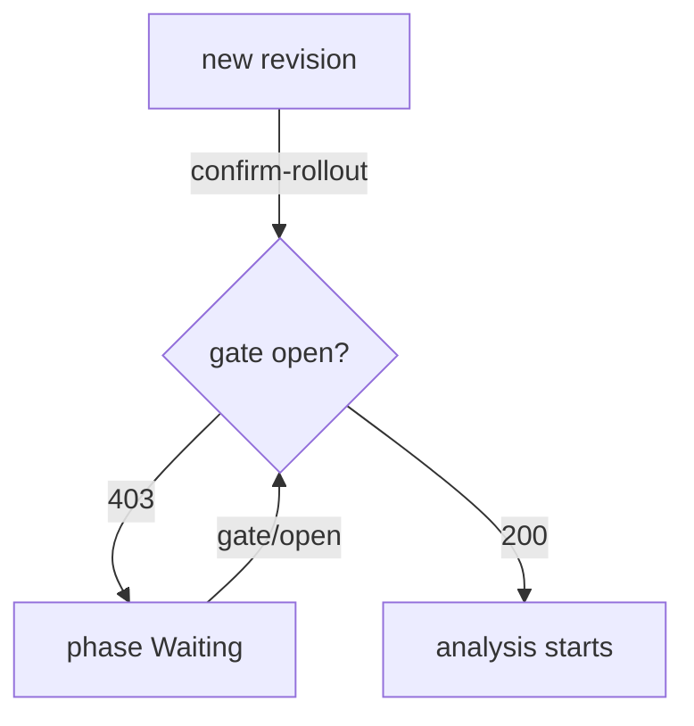

# Webhooks And Gates

Metrics measure what the router counts. They cannot run a smoke test of a login page, ask a person whether a release may start, or wait for a database migration. A webhook can. A webhook is an HTTP call that Flagger makes at a defined point of a release; if the call fails, so does the check or the step. This part lists the points where Flagger calls webhooks and uses one of them to hold a release until you open a gate.

## Webhook types

Every entry in `analysis.webhooks` has a `name`, a `url`, a `timeout` and a `type`. The `type` decides when Flagger calls it. When a webhook has no `type`, it is a `rollout` webhook.

| Type | When Flagger calls it | What a failure does |
| --- | --- | --- |
| `confirm-rollout` | Before the analysis starts, until it succeeds | The release waits in the phase `Waiting` |
| `pre-rollout` | Once, before traffic moves, after the new pods are ready | Counts as a failed check; too many roll back |
| `rollout` | At every interval, during the analysis | Counts as a failed check |
| `confirm-traffic-increase` | Before each increase of the weight | The weight stays where it is |
| `confirm-promotion` | Before the promotion, until it succeeds | The release waits in the phase `WaitingPromotion` |
| `post-rollout` | After a promotion or a rollback | Only logged; it cannot change the result |
| `rollback` | During the analysis and while waiting | When it succeeds, Flagger rolls the release back |
| `event` | At every event Flagger records | Only logged; it sends the event to an outside receiver |

A call is a `POST` request with a JSON body. The body holds the `name` and the `namespace` of the `Canary`, its `phase`, a `checksum` and the `metadata` map from the webhook entry. Any answer with a 2xx status passes. Any other status, and a timeout, fails. The `metadata` map is free for the receiver; the Flagger load tester reads `cmd` from it and runs that command.

## The gates of the load tester

The load tester has a simple gate for the `confirm-*` webhooks. A gate is a state that is closed or open. Three paths work on it: `/gate/check` answers 200 when the gate is open and 403 when it is closed, `/gate/open` opens it, and `/gate/close` closes it. A `confirm-rollout` webhook that points at `/gate/check` therefore holds every release until a person or a system calls `/gate/open`.



The diagram shows the release waiting at the gate and starting the analysis once the gate opens.

## Add the gate

This part needs the `Canary` `podinfo` with a weighted analysis, as in the earlier parts, your clone of `gitops/fleet`, and the port-forward to Gitea running in a second terminal. Add this webhook to the `webhooks` list of `apps/podinfo/canary.yaml`, above `load-test`:

<!-- astrona:playground:renew -->

```yaml
      - name: approve-release
        type: confirm-rollout
        url: http://flagger-loadtester.podinfo/gate/check
        timeout: 5s
```

Commit and push. Then release `6.14.1` in the same way as in the earlier parts:

```sh
git commit -am "Hold releases at a gate"
git push
sed -i.bak 's/newTag: 6.14.0/newTag: 6.14.1/' apps/podinfo/kustomization.yaml && rm apps/podinfo/kustomization.yaml.bak
git commit -am "Release podinfo 6.14.1"
git push
flux reconcile kustomization podinfo --with-source
kubectl -n podinfo get canary podinfo
```

The status is `Waiting`. Flagger scaled the new version up, but the gate is closed, so it does not shift any traffic. The events say that the approval is waiting. Open the gate for this release:

```sh
kubectl -n podinfo exec deploy/flagger-loadtester -- \
  curl -s -d '{"name":"podinfo","namespace":"podinfo"}' http://flagger-loadtester.podinfo/gate/open
kubectl -n podinfo get canary podinfo --watch
```

Within one interval the status becomes `Progressing`, and the analysis runs as usual. Stop the watch with Ctrl+C. The gate stays open for later releases of the same `Canary`, so close it again when the release is done:

```sh
kubectl -n podinfo exec deploy/flagger-loadtester -- \
  curl -s -d '{"name":"podinfo","namespace":"podinfo"}' http://flagger-loadtester.podinfo/gate/close
```

A real gate does not need a person: a pipeline can call the open address when its own tests pass. In both cases the decision is a call to an address, and the `Canary` keeps the rule in Git.

You can now name the points where Flagger calls out, hold a release at a gate, and open it. The next question is how people hear about a release that nobody watches.

## Common pitfalls

> [!WARNING]
> - **A `confirm-rollout` webhook with a gate nobody opens.** Every release waits in `Waiting` until the progress deadline.
> - **Leaving the gate open.** The next release starts without approval.
> - **Expecting `post-rollout` to undo a promotion.** It runs after the result and only reports.
> - **A webhook that answers 200 on error.** Flagger reads the status code, not the text.
> - **A `timeout` shorter than the check needs.** The call fails, and so does the check.
